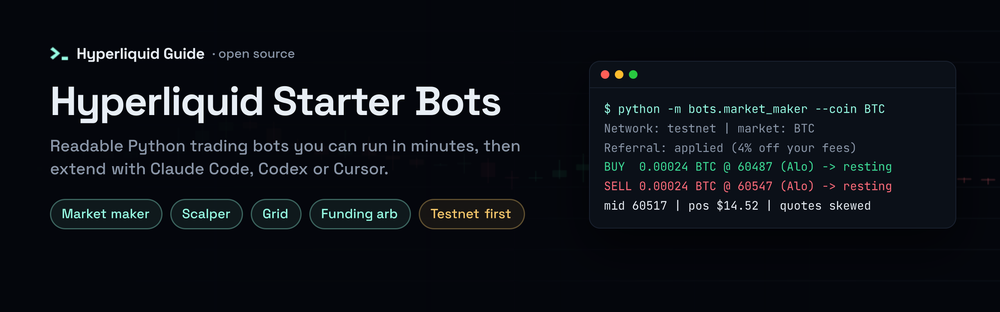
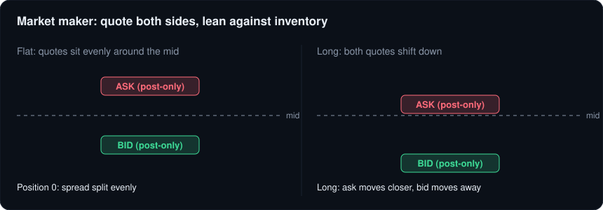
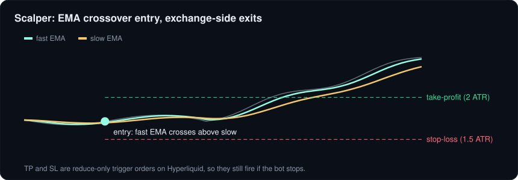
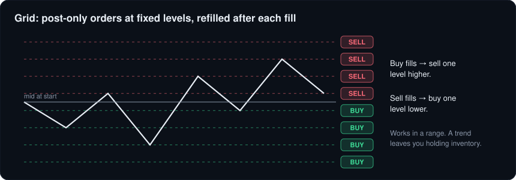
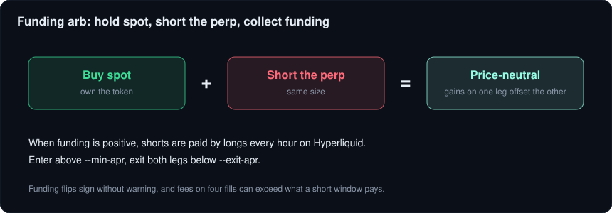
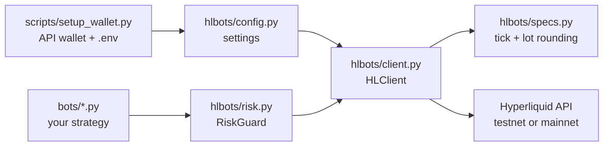

<p align="center">
  
</p>

<p align="center">
  <a href="https://github.com/Hyperliquidguide/hyperliquid-starter-bots/actions/workflows/tests.yml"></a>
  
  <a href="LICENSE"></a>
  
  
  
  <a href="https://hyperliquidguide.com/build"></a>
</p>

<p align="center">
  <b>Four small, readable trading bots for <a href="https://app.hyperliquid.xyz/join/CONCEPT211">Hyperliquid</a>.</b><br>
  Run one on testnet in five minutes, then have your coding agent turn it into your own strategy.
</p>

<!-- mcp-name: io.github.Hyperliquidguide/hyperliquid-guide -->

> [!WARNING]
> **No returns are promised.** These bots are teaching code with no proven edge. Real money can be lost, fast. Start on testnet and read [DISCLAIMER.md](DISCLAIMER.md).

<p align="center">
  
</p>

## Why this repo

- **Short enough to read.** Each bot is one file of a couple hundred lines, built on the official [hyperliquid-python-sdk](https://github.com/hyperliquid-dex/hyperliquid-python-sdk).
- **The fiddly parts are already solved.** Tick and lot rounding, the $10 minimum, rejected orders that still return HTTP 200, HIP-3 market names, API wallets and unified accounts.
- **Risk limits come built in.** Each bot has a max order size, a max position and a daily loss kill switch, plus dry-run mode and testnet by default.
- **Coding agents can extend it.** [AGENTS.md](AGENTS.md) gives Claude Code, Codex or Cursor the layout and the rules, so it can add a strategy without breaking the safety rails.

## The bots

### Market maker · `bots/market_maker.py`

Quotes a post-only bid and ask around the mid and leans both quotes against your inventory, so a long position gets sold down first.

```bash
python -m bots.market_maker --coin BTC --spread-bps 10 --order-usd 15
```



### Scalper · `bots/scalper.py`

Enters on a fast/slow EMA crossover and places the stop-loss and take-profit as trigger orders on Hyperliquid itself, so they still fire if your machine goes down.

```bash
python -m bots.scalper --coin ETH --interval 1m --stop-atr 1.5 --tp-atr 2
```



### Grid · `bots/grid.py`

Places post-only orders at fixed price levels. Each filled buy is replaced by a sell one level up, and each filled sell by a buy one level down.

```bash
python -m bots.grid --coin BTC --range-pct 2 --levels 8 --order-usd 12
```



### Funding arb · `bots/funding_arb.py`

When a perp's funding is positive enough, it buys the spot token and shorts the same size on the perp, then exits both legs when funding falls.

```bash
python -m bots.funding_arb --coin HYPE --min-apr 20 --exit-apr 5
```



Every bot takes `--help`, `--dry-run` and `--run-seconds`. HIP-3 markets use their dex prefix, for example `--coin xyz:XYZ100`.

## Quick start (testnet)

You need Python 3.10+ and a wallet that has made a deposit on Hyperliquid mainnet (the testnet faucet requires one).

```bash
git clone https://github.com/Hyperliquidguide/hyperliquid-starter-bots
cd hyperliquid-starter-bots
python -m venv .venv && source .venv/bin/activate   # Windows: .venv\Scripts\activate
pip install -r requirements.txt

# 1. Get testnet USDC: https://app.hyperliquid-testnet.xyz/drip
# 2. Create an API wallet for the bots (asks for your main key, never saves it)
python -m scripts.setup_wallet

# 3. See what the bot sees
python -m scripts.check_account --coin BTC

# 4. Watch a bot think without sending orders, then run it for real on testnet
python -m bots.market_maker --coin BTC --dry-run
python -m bots.market_maker --coin BTC
```

## How it fits together



## Build your own strategy with a coding agent

Open the repo in Claude Code, Codex or Cursor and ask for what you want. The agent reads [AGENTS.md](AGENTS.md) (Claude Code loads it through `CLAUDE.md`) and follows the same rules as the bundled bots. Prompts that work:

- *"Add a bot in `bots/breakout.py` that buys a 20-candle high on the 5m chart, with an ATR stop and tests."*
- *"Make the market maker widen its spread when 5-minute volatility rises, and test the spread function."*
- *"Give the scalper a funding filter: only go long when funding is negative."*
- *"Run the grid bot in dry-run on `xyz:XYZ100` and explain every order it would place."*

For Hyperliquid details (fees, rate limits, error messages, HIP-3 markets) point the agent at the [agent quickstart](https://hyperliquidguide.com/agents/quickstart.md) or [llms.txt](https://hyperliquidguide.com/llms.txt).

## Use it from your coding agent

This repo also ships a **read-only MCP server** and an **Agent Skill**, so your agent can look up live Hyperliquid specs instead of guessing. The server holds no keys and places no orders. Its tools: `market_specs`, `round_order`, `top_funding`, `explain_error`, `account_status`, `quickstart`, `starter_bot` ([details](hlmcp/README.md)). It runs through [uv](https://docs.astral.sh/uv/).

**Claude Code** (plugin: skill + MCP in one step)

```text
/plugin install hyperliquid-guide --marketplace Hyperliquidguide/hyperliquid-starter-bots
```

**Claude Code** (MCP only)

```bash
claude mcp add hyperliquid-guide -- uvx --from git+https://github.com/Hyperliquidguide/hyperliquid-starter-bots hl-guide-mcp
```

**Codex**

```bash
codex mcp add hyperliquid-guide -- uvx --from git+https://github.com/Hyperliquidguide/hyperliquid-starter-bots hl-guide-mcp
```

**Cursor, Claude Desktop and other MCP clients** (add to `mcp.json` / `claude_desktop_config.json`)

```json
{
  "mcpServers": {
    "hyperliquid-guide": {
      "command": "uvx",
      "args": ["--from", "git+https://github.com/Hyperliquidguide/hyperliquid-starter-bots", "hl-guide-mcp"]
    }
  }
}
```

**Agent Skill only** (Claude Code, Codex, Cursor and [other skills-compatible agents](https://github.com/vercel-labs/skills))

```bash
npx skills add Hyperliquidguide/hyperliquid-starter-bots
```

## Going to mainnet

Run `python -m scripts.setup_wallet --mainnet`, deposit USDC, and keep the default small sizes until you've watched the bot through a few volatile hours. The bots read `HL_NETWORK` from `.env`, so nothing touches mainnet until you set it.

## Safety

- **Use an API wallet.** It can trade but can't withdraw. `setup_wallet` creates one, and the bots warn you if they're given your main key.
- **Keys stay local.** `.env` is gitignored. Never paste a key into a chat, an issue or a commit.
- **The risk limits are a floor.** Tighten them before you size up.
- **Exits that live on the exchange keep working.** The scalper's stop-loss still fires if your machine dies. The market maker and grid bots cancel their orders when they exit.

## Referral disclosure

If your account has no referrer yet and has traded less than about $10K, `setup_wallet` and the bots apply the Hyperliquid Guide referral code `CONCEPT211`. Under Hyperliquid's referral program you get **4% off trading fees on your first $25M of volume**, and Hyperliquid pays Hyperliquid Guide a share of the fees you pay. You pay less, not more. It never replaces an existing referrer, and it's skipped on testnet.

To opt out, set `HL_REFERRAL=off` in `.env`. To use a different code, set `HL_REFERRAL_CODE`.

## Tests

```bash
python -m pytest
```

They run offline with no keys. CI runs them on Python 3.10 and 3.12.

## More from Hyperliquid Guide

- [Build a Hyperliquid bot with Claude Code or Codex](https://hyperliquidguide.com/build)
- [Grid bot guide](https://hyperliquidguide.com/guides/trading/hyperliquid-grid-bot)
- [Funding rate arbitrage guide](https://hyperliquidguide.com/guides/trading/hyperliquid-funding-rate-arbitrage)
- [Hyperliquid MCP servers compared](https://hyperliquidguide.com/guides/trading/hyperliquid-mcp-server)
- [Hyperliquid API guide](https://hyperliquidguide.com/guides/trading/hyperliquid-api-guide)
- [Market making on Hyperliquid](https://hyperliquidguide.com/guides/trading/hyperliquid-market-making-guide)
- [Fees and VIP tiers](https://hyperliquidguide.com/guides/fees/fees-explained)

---

<sub>Maintained by <a href="https://hyperliquidguide.com">Hyperliquid Guide</a>, an independent site. Not affiliated with, endorsed by, or reviewed by Hyperliquid or the Hyper Foundation. MIT licensed. Graphics are regenerated with <code>tools/make-assets.mjs</code>.</sub>
